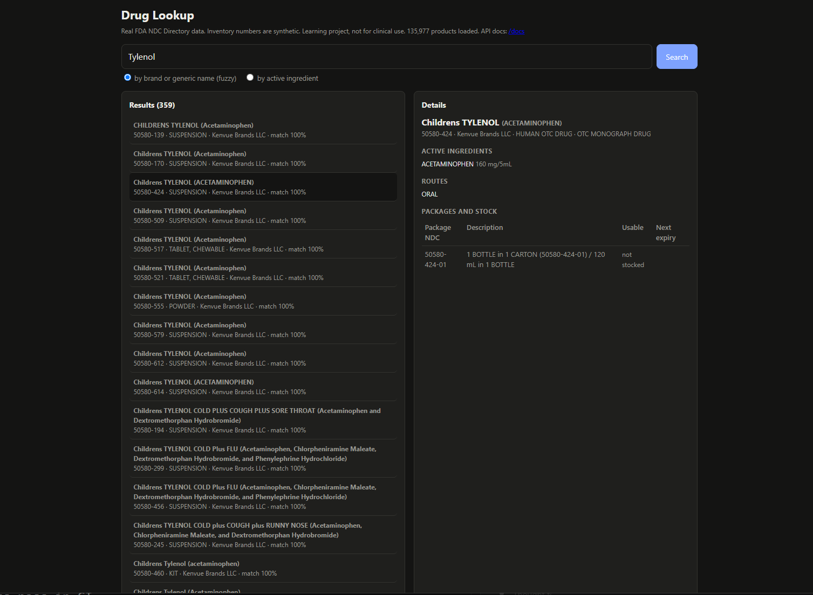
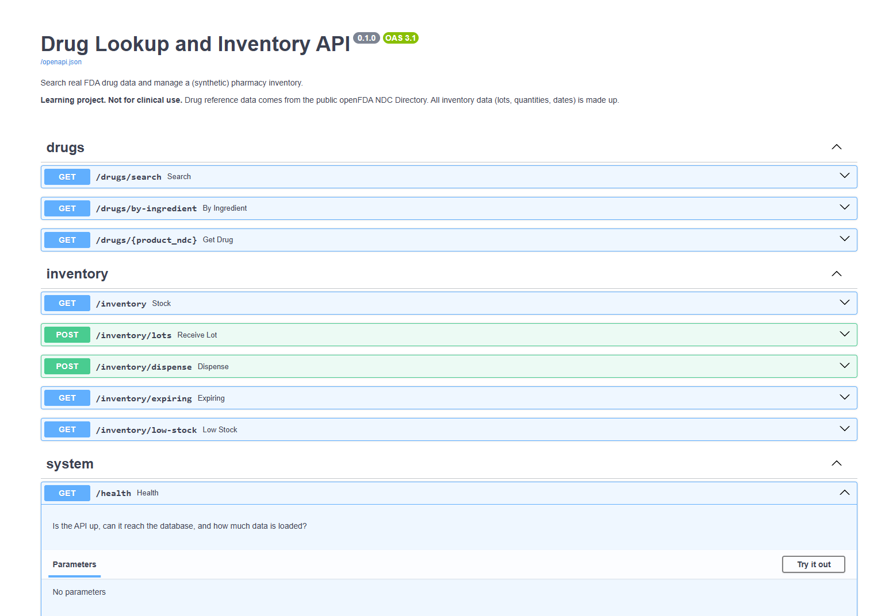
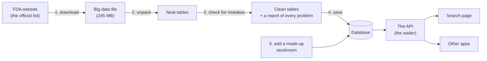
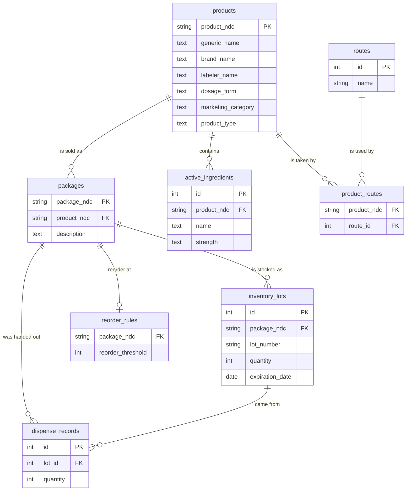

# Drug Lookup and Inventory API

[](https://github.com/Masfiq/drug-lookup-inventory-api/actions/workflows/ci.yml)

> **Heads up: this is a school-style learning project, not a real medical tool.**
> The list of drugs is real (it comes from the U.S. government). The stockroom numbers
> (how many boxes, when they expire) are **made up**. Never use this to make decisions about
> real medicine.



*The search page. I typed "Tylenol" and got 359 matches. Clicking one shows what is inside it,
how you take it, and what box sizes it comes in.*

---

## The idea in one minute

Think about what a pharmacy needs to know every day:

1. **"What is this medicine?"** There are over 100,000 medicines in the U.S. You need a way to
   look any of them up fast, even if you spell the name wrong.
2. **"Do we have it on the shelf?"** How many boxes, which ones expire soon, and which ones are
   almost gone and need to be reordered.

This project does both.

- **Part 1, the drug catalog** (real data). Like a library catalog, but for medicine. Type a
  name, get the answer.
- **Part 2, the stockroom** (made-up data). Like a video game inventory screen for a pharmacy:
  it tracks every box, knows when each one expires, and always hands out the one that expires
  first, so nothing goes to waste.

It is built as an **API**. An API is like a waiter for computer programs: a program asks
"find me metformin", the API goes to the kitchen (the database), and comes back with the answer.
There is also a simple web page (the picture above) so humans can try it too.

## Where does the drug data come from?

The **FDA** (the U.S. Food and Drug Administration, the government agency in charge of medicine)
publishes a free list of every drug product sold in the country. It is called the
**NDC Directory**. Anyone can download it.

This project downloads that list, which is 138,427 records, checks it for mistakes, and saves it
in a database. After cleaning, you can search **135,977 medicines**.

## What can I look up?

Almost any medicine sold in the U.S.:

| Kind | How many | Examples to try |
| --- | ---: | --- |
| Prescription medicines (you need a doctor's note) | 56,500 | Lipitor, Eliquis, Ozempic, amoxicillin, insulin |
| Over-the-counter medicines (you can just buy them) | 56,489 | Tylenol, Advil, Zyrtec, sunscreen, cough syrup |
| Raw ingredients pharmacies use to make medicine | 15,253 | |
| Vaccines, allergy tests, and other special items | about 7,700 | |

**Fun things to try:**

- **Spell it wrong on purpose:** `ibuprofin`, `amoxicilin`, `metfromin`, `atorvastatn`.
  It still finds the right medicine.
- **Switch to "by active ingredient"** and type `acetaminophen` to see every product that
  contains it (Tylenol, cold medicines, and more).
- **Click any result** to see what is inside it, how you take it (swallow it, put it on your skin,
  inject it), and every box size it comes in.

Why does "Tylenol" show 359 results? Because each version counts separately: children's liquid,
chewable tablets, cold and flu mixes, and so on. Common medicines like atorvastatin are also made
by hundreds of different companies, and each one is listed.

You **won't** find medicines that are only sold in other countries (for example "Panadol", which
is the same thing as acetaminophen), drugs that are no longer sold, or most vitamins and
supplements.

## Words you will see

| Word | What it means |
| --- | --- |
| **NDC** | National Drug Code. The ID number of a medicine, like a barcode. `58151-155` is Lipitor 10 mg. |
| **Product** | One specific medicine from one company, like "Lipitor 10 mg tablets". |
| **Package** | One way that medicine is sold, like "a bottle of 90 tablets". Each package has its own NDC. |
| **Active ingredient** | The part of the medicine that actually does the work. In Tylenol it is acetaminophen. |
| **Route** | How the medicine gets into your body: ORAL (you swallow it), TOPICAL (on your skin), and so on. |
| **Lot** | One delivery of boxes from the factory. Every lot has its own expiration date. |
| **FEFO** | "First Expiring, First Out." Always use the box that expires soonest. |
| **Database** | Where all the data is saved. It is organized in **tables**, like tabs in a spreadsheet. |
| **API** | A way for programs to ask other programs for data. |
| **Index** | A shortcut that helps the database find things fast, like the index at the back of a textbook. |

## The control panel (API docs)



*Every "door" into the API, listed on one page. Open http://127.0.0.1:8001/docs, click any
row, then click **Try it out** to send a real request and see the real answer. No coding needed.*

Here is what each door does:

| Door | What it does |
| --- | --- |
| `GET /drugs/search` | Search by name (typos are OK) |
| `GET /drugs/by-ingredient` | Find every medicine with a certain ingredient |
| `GET /drugs/{product_ndc}` | Everything about one medicine |
| `GET /inventory` | How much of each package is on the shelf |
| `POST /inventory/lots` | A new delivery arrived: add it to the shelf |
| `POST /inventory/dispense` | Hand out medicine, using the box that expires first |
| `GET /inventory/expiring` | Which boxes expire soon? |
| `GET /inventory/low-stock` | What is running out and needs reordering? |
| `GET /health` | Is everything working? |

"GET" means "show me something". "POST" means "change something". The full details for each one
are in [`docs/API.md`](docs/API.md).

## How it works, step by step



1. **Download** the FDA's file.
2. **Unpack it.** The FDA file is like a set of Russian nesting dolls: each medicine has lists
   inside it (its packages, its ingredients). A database wants flat rows, like a spreadsheet, so
   each list gets unpacked into its own table.
3. **Check for mistakes.** Real data has errors. We count every problem and write it in a
   report. We never secretly throw anything away.
4. **Save it** in the database.
5. **Make up a stockroom** for 20,000 real packages, so the inventory part has something to work
   with.

## How the data is organized

The data is split into several tables that point at each other. This is called
**normalization**. The rule is simple: **write every fact down only once.**



How to read this picture: each box is a table, and the lines show how they connect. "PK" is the
row's ID. "FK" means "this points at a row in another table".

**Why not just one giant table?**

- **One medicine can come in many box sizes and have many ingredients.** In one big table you
  would need columns like `box_1`, `box_2`, `box_3`... and you never know when to stop. Separate
  tables let each medicine have as many as it needs.
- **Routes are shared.** "ORAL" is used by about 67,000 medicines. Instead of writing "ORAL"
  67,000 times, it is written once in the `routes` table, and a small link table connects
  medicines to routes. If you ever needed to fix a typo in a route name, you would change one row
  instead of 67,000.
- **The stockroom tracks boxes, not medicines,** because pharmacies stock boxes. So the
  inventory tables point at `packages`.
- **Every handout is recorded with the exact lot it came from.** If a factory ever says "lot
  AB123 was bad", the pharmacy can find everyone who got it.

## The mistakes we found in the real data

You might expect government data to be perfect. It is not. Here is what the checks found in the
FDA file from **October 13, 2026**:

| Problem | How many | What we did |
| --- | ---: | --- |
| The same medicine listed more than once | 2,450 extra copies | Kept the best one, combined their box sizes |
| Medicines with no box sizes listed | 364 | Kept them (you can still look them up) |
| Medicines with no ingredients listed | 2,516 | Kept them (common for raw materials) |
| Medicines with no generic name | 3 | Kept them (they still have a brand name) |
| Broken box ID numbers, like `02` and `47848-026-XX` | 2 | Removed (you cannot find a box with a broken ID) |
| The same box listed twice | 4 | Kept one |
| The same route listed twice for one medicine | 27 | Kept one |

In total: 5,366 problems found and 2,483 rows removed, and **every single one is written down
with a reason**. The full report, with examples, is in
[`reports/data_quality_report.md`](reports/data_quality_report.md).

**Loading the data twice is safe.** When we ran the loader a second time, it said "0 new, 0
changed, 135,977 the same". It does not create copies. Programmers call this **idempotent**: you
can do it again without messing anything up.

## Making it fast

Imagine looking for one word in a 1,000-page book with no index: you would have to read every
page. Databases have the same problem. An **index** is the shortcut.

We timed three searches **without** indexes and then **with** them:

| Search | Without index | With index | How much faster |
| --- | ---: | ---: | ---: |
| Find "atorvastatn" (spelled wrong on purpose) | 488.8 ms | 4.7 ms | 104 times |
| Find medicines with an ingredient starting with "metformin" | 42.4 ms | 1.3 ms | 33 times |
| Find boxes expiring in the next 30 days | 2.46 ms | 0.03 ms | 82 times |

"ms" means milliseconds: one thousandth of a second. A blink takes about 100 ms. So the slow name
search took about five blinks, and the fast one takes about a twentieth of a blink.

**How each shortcut works:**

- **Name search:** every name is chopped into 3-letter pieces. "lipitor" becomes "lip", "ipi",
  "pit", "ito", "tor". The index remembers which medicines have each piece. A typo only breaks a
  couple of pieces, so the right medicine still matches most of them. That is how misspelled
  searches still work, and fast.
- **Ingredient search:** ingredient names are kept in alphabetical order, like a phone book. To
  find everything starting with "metformin", jump to "M" instead of reading every name.
- **Expiring boxes:** boxes are kept sorted by expiration date, so "the next 30 days" is just one
  short slice at the front of the list.

**Bonus, the memory trick (a "cache"):** the API remembers popular searches for 5 minutes. The
first time someone searches "ibuprofen" it takes about 25.7 ms; after that it takes about 0.8 ms,
because the answer is already in memory.

All of these were measured on one computer (AMD Ryzen 7 7700X, Windows 11). A different computer
will give different numbers, but the "before vs after" difference should look about the same.
The full report is in [`reports/performance_report.md`](reports/performance_report.md).

## The clever parts, explained simply

**FEFO: the milk rule.** When you grab milk from the fridge, you take the one that expires first,
so nothing goes bad. The stockroom does the same with medicine. Ask for 30 pills, and it might
take 5 from a box expiring next week and 25 from one expiring next month. It never hands out
expired medicine.

**All or nothing (a "transaction").** Taking 5 from one box and 25 from another is two changes.
What if the computer crashed right in the middle? The numbers would be wrong. A transaction makes
sure that **either every change happens, or none of them do**. Same idea when loading the FDA
data: if anything breaks halfway, the database goes back to exactly how it was.

**No double-grabbing (a "lock").** What if two pharmacists ask for the last 10 pills at the exact
same moment? The first request "locks" those boxes, and the second one has to wait its turn.
Then it sees there is nothing left and gets a clear "not enough stock" message. We tested this
by firing 10 requests at the same instant for 50 pills: exactly 5 got their pills, and the shelf
ended at exactly 0. Never below.

**Expired medicine is never handed out,** but it is still counted, so the pharmacy knows what it
needs to throw away.

**Never delete quietly.** If a medicine disappears from a newer FDA list, it is counted but not
deleted, because the pharmacy might still have it on the shelf.

Want the grown-up technical version (great for job interviews)? Read
[`docs/HOW_IT_WORKS.md`](docs/HOW_IT_WORKS.md).

## How to run it on your computer

You need **Python 3.11 or newer**. Docker Desktop is the easiest way to get the database.

**Step 1: start the database**

```bash
docker compose up -d db
```

**Step 2: set up Python (only the first time)**

```bash
python -m venv .venv
.venv\Scripts\activate                 # on Mac or Linux: source .venv/bin/activate
pip install -e ".[dev]"
```

**Step 3: load the FDA data (only the first time)**

```bash
python -m app.cli load-all
```

This downloads the FDA file, cleans it, saves it, and makes up the stockroom. Loading took 31.5
seconds on the test computer.

**Step 4: start the API**

```bash
python -m app.cli run
```

Now open:

- http://127.0.0.1:8001 for the search page
- http://127.0.0.1:8001/docs for the control panel

**Or let Docker do everything:** `docker compose up -d`, then
`docker compose exec api python -m app.cli load-all`, then open http://localhost:8001.

**Seeing "This site can't be reached"?** The API is not running. Check the terminal where you ran
`python -m app.cli run`. If it says *"Cannot connect to the database"*, the database is off:
start it again (Step 1), then rerun Step 4. This happens after your computer restarts.

**Other handy commands**

| Command | What it does |
| --- | --- |
| `python -m app.cli download` | Just download the FDA file |
| `python -m app.cli load` | Just clean and save it, and write the mistakes report |
| `python -m app.cli seed-inventory` | Throw away the stockroom and make up a fresh one |
| `python -m app.cli benchmark` | Time the three searches with and without indexes |
| `pytest --cov` | Run all the tests |

## Talking to the API from the terminal

If you like typing commands, here are some to copy and paste:

```bash
# Search with a typo
curl "http://127.0.0.1:8001/drugs/search?q=atorvastatn&limit=3"

# Everything about Lipitor 10 mg
curl "http://127.0.0.1:8001/drugs/58151-155"

# Every medicine with metformin in it
curl "http://127.0.0.1:8001/drugs/by-ingredient?name=metformin"

# The stockroom: what is on the shelf, what expires soon, what is running low
curl "http://127.0.0.1:8001/inventory?limit=5"
curl "http://127.0.0.1:8001/inventory/expiring?days=30"
curl "http://127.0.0.1:8001/inventory/low-stock"

# A delivery arrived: 100 bottles of Lipitor 10 mg
curl -X POST http://127.0.0.1:8001/inventory/lots -H "content-type: application/json" \
  -d '{"package_ndc":"58151-155-77","lot_number":"AB12345","quantity":100,"expiration_date":"2028-06-30"}'

# Hand out 30, using the milk rule (FEFO)
curl -X POST http://127.0.0.1:8001/inventory/dispense -H "content-type: application/json" \
  -d '{"package_ndc":"58151-155-77","quantity":30,"reference":"RX-1001"}'
```

What a real answer looks like (from the typo search):

```json
{"query": "atorvastatn", "total": 515,
 "items": [{"product_ndc": "0615-8006", "brand_name": "ATORVASTATIN CALCIUM",
            "labeler_name": "NCS HealthCare of KY, LLC dba Vangard Labs",
            "dosage_form": "TABLET, FILM COATED", "score": 0.833}]}
```

`score` is how close the name is to what you typed, from 0 (nothing alike) to 1 (perfect). Even
with the typo, it scored 0.833.

When something goes wrong, the API always explains it the same way:

```json
{"error": {"code": "insufficient_stock",
           "message": "Requested 99999 units but only 810 usable units are in stock",
           "details": {"requested": 99999, "available": 810}}}
```

## How do we know it works?

We wrote **87 automatic tests**. Each one is a little robot that checks one thing, like "does a
typo still find the medicine?" or "can two people grab the same last pills?". All 87 pass.

- 42 tests check small pieces on their own (the milk rule, ID formats, the mistake checks, the
  memory trick).
- 45 tests run against a real database (searching, the stockroom, loading data, crashing on
  purpose to prove nothing gets half-saved).
- The tests touch **97%** of the code.
- The tests use a small file of **20 real FDA records**, picked so that every kind of mistake
  shows up at least once, plus 1 broken record added on purpose.
- Every time the code is uploaded to GitHub, the tests run automatically (that is the green
  "CI" badge at the top).

## What is in each folder

```
app/
  domain/        the rules, like FEFO (the milk rule) and what a valid NDC looks like
  etl/           download, unpack, check for mistakes, save, make up the stockroom
  db/            what the database tables look like
  services/      the actual work: searching, managing the stockroom
  api/           the "doors" other programs knock on
  static/        the search page
alembic/         step-by-step instructions for building the database
docs/            the detailed, technical documentation
img/             the screenshots in this file
reports/         the mistakes report and the speed report, both made by the code
scripts/         small helper tools
tests/           the 87 test robots
```

## Ideas for later

- Download the newest FDA list every week automatically and report what changed (the loader
  already counts new, changed, and unchanged medicines).
- Logins, so only real pharmacists can hand out medicine.
- Connect it to my other project, the
  [Pharmacy Fulfillment Service](https://github.com/Masfiq/pharmacy-fulfillment-service), as its
  stockroom. Both use the same box ID numbers, so they fit together.
- Handle recalls: "show me everyone who got medicine from lot AB123".

## Want more detail?

| Document | What is inside |
| --- | --- |
| [`docs/HOW_IT_WORKS.md`](docs/HOW_IT_WORKS.md) | The technical design, for programmers and interviews |
| [`docs/DATA.md`](docs/DATA.md) | Exactly which FDA fields we use and every mistake check |
| [`docs/API.md`](docs/API.md) | Every door of the API, with examples |
| [`reports/data_quality_report.md`](reports/data_quality_report.md) | The full mistakes report |
| [`reports/performance_report.md`](reports/performance_report.md) | The full speed report |
