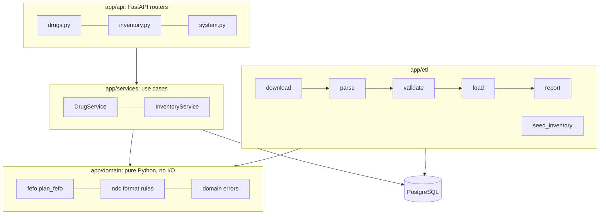

# How it works (technical design)

This is the engineering version of the README: what each part does, why it is built that way,
and what the tradeoffs are. Every number here comes from a real run (see `reports/`).

## Layers



- **Routers** only translate HTTP into service calls and back. No SQL there.
- **Services** hold the queries and transactions.
- **Domain** code has no database or web imports, so it is tested with plain unit tests.
- **Errors** are domain exceptions (`NotFoundError`, `InsufficientStockError`, ...). One handler
  in `app/api/errors.py` maps each to an HTTP status with the same JSON shape:
  `{"error": {"code", "message", "details"}}`.

## Schema and normalization

The FDA record is one nested document per product. The schema is in third normal form:

| Table | One row per | Key | Why it is separate |
| --- | --- | --- | --- |
| `products` | FDA product | `product_ndc` | the entity everything else hangs off |
| `packages` | sellable package | `package_ndc` | 1 product has N packages; inventory is per package |
| `active_ingredients` | ingredient of a product | surrogate `id` | 1 product has N ingredients; queried on its own (`by-ingredient`) |
| `routes` | distinct route name | `id`, `name` unique | 72 names shared by 121,231 links: store each once |
| `product_routes` | product/route pair | (`product_ndc`, `route_id`) | the many-to-many link; composite PK prevents duplicates |
| `inventory_lots` | received batch | `id`, unique (`package_ndc`, `lot_number`) | many lots per package, each with its own expiry |
| `reorder_rules` | package | `package_ndc` | 0 or 1 rule per package |
| `dispense_records` | lot used in a dispense | `id` | lot level traceability for recalls |
| `etl_runs` | data load | `id` | history of loads and what changed |

Notes:

- `products.search_text` is a **generated column**:
  `lower(coalesce(brand_name,'') || ' ' || coalesce(generic_name,''))`. PostgreSQL keeps it in sync,
  and one trigram index on it serves search on both names.
- `ON DELETE CASCADE` on ingredient and route links lets the loader replace children cleanly.
  `inventory_lots` does **not** cascade from `packages`: stock must never vanish because a
  reference row changed.
- CHECK constraints (`quantity >= 0`, `reorder_threshold >= 0`, dispense `quantity > 0`) are the
  last line of defense if application code has a bug.
- `packages.package_ndc` is the same identifier Project 1 uses as `drugs.ndc`, so this can become
  Project 1's inventory module.

## ETL

### Parse (pandas)

`app/etl/parse.py` builds a DataFrame from the records and `explode`s each list column
(`packaging`, `active_ingredients`, `route`) into its own frame. Every row keeps `source_row`, the
index of the FDA record it came from, so any issue can be traced to the original record.

### Validate

`app/etl/validate.py` runs 12 checks. Each returns an `Issue(code, description, action, count,
examples)`. `action` is `dropped` (row cannot be stored safely) or `kept` (stored and reported).
The full list, with reasons, is in [DATA.md](DATA.md). Two decisions worth explaining:

- **Duplicate product NDCs (2,450 extra listings).** These are not copies; they are separate label
  documents (different `spl_id`) for the same product NDC. We keep one per NDC, preferring
  `finished = true`, then the latest `marketing_start_date`, then `spl_id` for a stable tie break.
  Packages from **all** listings are merged, because they are real distinct packages.
- **Malformed NDCs** are dropped only for packages (`02` cannot identify a box). Malformed
  product NDCs would be kept because they are still unique keys (the current file has none).

### Load: idempotent, one transaction, with change detection

```sql
INSERT INTO products (...) VALUES (...)
ON CONFLICT (product_ndc) DO UPDATE SET ... = excluded....
WHERE (products.generic_name, ...) IS DISTINCT FROM (excluded.generic_name, ...)
RETURNING product_ndc, (xmax = 0) AS inserted;
```

- `ON CONFLICT DO UPDATE` makes a rerun update instead of failing on duplicate keys.
- The `WHERE ... IS DISTINCT FROM` skips rows whose values did not change, so they are not
  rewritten and are not returned.
- `xmax = 0` is true for a freshly inserted row and false for an updated one.
- So: inserted = returned with `inserted`, updated = returned without, unchanged = sent minus
  returned. A second run reported 0 inserted, 0 updated, 135,977 unchanged.
- Ingredients and route links for loaded products are deleted and re-inserted (cheap, and they
  have no identity anyone depends on).
- Everything runs in **one transaction**, sent in batches of 5,000 rows. A failure anywhere rolls
  back the whole load (tested by forcing a failure at the last step). Readers keep seeing the old
  data until commit.
- Products missing from a newer file are **counted, not deleted** (`products_not_in_source`):
  inventory may still reference their packages.

Measured: the first full load (138,427 records) took 31.5 s end to end on the dev machine.

## Search

```sql
SELECT products.*, word_similarity(:q, search_text) AS score
FROM products
WHERE search_text %> :q          -- same as  :q <% search_text
ORDER BY score DESC, brand_name NULLS LAST, product_ndc
```

- `word_similarity` compares the query with the best matching run of words in the text, so
  "lipitor" matches "lipitor atorvastatin calcium" with score 1.0.
- The threshold is set per transaction with `set_config('pg_trgm.word_similarity_threshold',
  '0.4', true)`. Why 0.4: a swapped-letter typo ("metfromin" vs "metformin") scores 0.43. At 0.5
  that search found 27 products; at 0.4 it found 773 (all the metformin products), while
  "lipitor", "atorvastatn", and "ibuprofin" returned the same results as before.
- Only the operator form (`%>`) can use the GIN index. Writing `word_similarity(...) > 0.4` in
  the WHERE clause would force a full scan.
- `by-ingredient` uses `lower(name) LIKE 'metformin%'` with SQLAlchemy `autoescape`, so `%` and
  `_` typed by a user are literal characters, not wildcards (tested).

## Inventory and FEFO

`app/domain/fefo.py:plan_fefo(lots, quantity, today)`:

1. Keep lots with `quantity > 0` and `expiration_date >= today` (a lot is usable through its
   expiry date).
2. Sort by `(expiration_date, received_at, lot_id)`: earliest expiry first, deterministic ties.
3. If total usable < requested, raise `InsufficientStockError` with the available amount and
   change nothing.
4. Otherwise take `min(lot.quantity, remaining)` from each lot in order.

`InventoryService.dispense` wraps it in a transaction:

```
BEGIN
  SELECT ... FROM inventory_lots WHERE package_ndc = :p AND quantity > 0 FOR UPDATE
  plan = plan_fefo(...)                  -- pure function
  UPDATE inventory_lots SET quantity = quantity - :n WHERE id = :lot   -- per allocation
  INSERT INTO dispense_records ...                                     -- per allocation
COMMIT
```

- `FOR UPDATE` locks that package's lots. A concurrent dispense for the same package blocks on
  the SELECT until the first commits, then reads the new quantities. Dispenses for different
  packages do not block each other.
- Lots are locked in `id` order, so two transactions always take locks in the same order (no
  deadlock between dispenses).
- On `InsufficientStockError` the session rolls back immediately to release the locks.
- Test: 10 threads each dispense 10 units from 50 units at the same instant (a barrier releases
  them together). Exactly 5 succeed and stock ends at 0.

Stock levels (`GET /inventory`, `/low-stock`) split `usable_quantity` (not expired) and
`expired_quantity`. Low stock compares **usable** stock with the threshold, because expired units
cannot be dispensed.

## Indexes (migration 0002)

| Index | Type | Serves | Before | After |
| --- | --- | --- | ---: | ---: |
| `ix_products_search_text_trgm` | GIN, `gin_trgm_ops` on `search_text` | fuzzy search | 488.8 ms (Seq Scan) | 4.7 ms (Bitmap Index Scan) |
| `ix_active_ingredients_name_prefix` | B-tree on `lower(name) text_pattern_ops` | ingredient prefix | 42.4 ms (Seq Scans) | 1.3 ms (Bitmap Index Scan + PK lookups) |
| `ix_inventory_lots_expiring` | partial B-tree on `expiration_date WHERE quantity > 0` | expiring lots | 2.46 ms (Seq Scan) | 0.03 ms (Index Scan) |

- **GIN trigram:** an inverted index from each 3-character trigram to the rows containing it.
  PostgreSQL intersects the trigram lists for the query, then rechecks the few candidates.
- **`text_pattern_ops`:** a normal B-tree only supports `LIKE 'abc%'` under the C collation. This
  operator class compares character by character, so the prefix search uses the index under any
  collation (Docker's default is `en_US.utf8`).
- **Partial index:** empty lots never need expiry alerts, so they are left out. The query
  repeats `quantity > 0` exactly so the planner can use it.
- The indexes live in their own migration so `python -m app.cli benchmark` can migrate down,
  measure, migrate up, and measure again on the same data. Each query gets one warm-up run, then
  the median of 7 `EXPLAIN ANALYZE` execution times.
- On the 21-record test fixture PostgreSQL correctly chooses sequential scans even with the
  indexes: an index only pays off once a table is large.

## Caching

`app/cache.py` is a small thread-safe TTL + LRU cache (5 minutes, 1,000 entries) for
`GET /drugs/search`, keyed by (normalized query, limit, offset). Responses carry `X-Cache: HIT` or
`MISS`; `/health` reports hits and misses.

Measured with `scripts/measure_cache.py` over HTTP, 10 popular queries, 20 repeats each: median
25.7 ms on a miss, 0.8 ms on a hit.

Tradeoffs: each API process has its own cache, and new FDA data can take up to 5 minutes to appear
in cached searches. Both are fine for reference data that changes weekly. Inventory endpoints are
never cached because stock changes constantly.

## Testing strategy

- **Unit (42):** FEFO edge cases, NDC formats, parsing, every quality check against real records,
  report rendering, cache expiry and eviction, and failing fast when the database is down.
- **Integration (45):** run against PostgreSQL (not SQLite) because the behavior under test is
  PostgreSQL behavior: `pg_trgm`, `FOR UPDATE`, `ON CONFLICT`, generated columns, partial indexes.
  The schema is built by the real migrations, and the fixture goes through the real pipeline.
- **Fixture:** `tests/fixtures/ndc_sample.json` holds 20 real FDA records chosen by
  `scripts/make_fixture.py` so each quality check has a real example, plus 1 injected record with
  no NDC (the real file has none). CI never downloads the full file.
- `compare_metadata` checks that models and migrations agree.

## Known limitations

- The search cache is per process; several API workers would each keep their own.
- The benchmark drops indexes temporarily, so run it only on a local database.
- Dates use the server's local date for "today"; a multi-timezone deployment would pass the
  pharmacy's time zone explicitly.
- `X-Cache` and caching apply only to name search.
